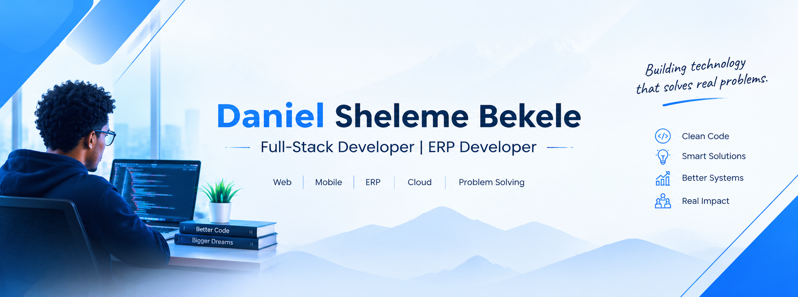

# Daniel Sheleme Bekele

### Full-Stack Developer | ERP Developer | Web & Mobile Apps

  

Building useful digital products for businesses, schools, and agriculture.

---

## 👨‍💻 About Me

- 🚀 Self-taught software developer and product builder.
- 🏫 Building school management and ERP systems.
- 📱 Developing web and mobile applications.
- 🌾 Interested in smart agriculture and e-commerce.
- 🌱 Always learning and improving my engineering skills.

## 🧰 Technologies & Tools

## 🚀 Featured Projects

### 🏫 Tullu Dimtu School ERP
School management software for student registration, attendance, academic records, and administration.

🌐 [Visit Website](https://tuludimtuschool.com)

### 🌾 Eco-Mers — Smart Agriculture & E-commerce
A project combining digital commerce and agriculture technology.

💻 [Explore My Repositories](https://github.com/danidan902?tab=repositories)

### 💼 DaniPort — Developer Portfolio
My portfolio for showcasing software development projects and services.

🌐 [Visit Portfolio](https://daniport.vercel.app)

## 📊 GitHub Activity

## 🤝 Connect With Me

- 💻 [GitHub](https://github.com/danidan902)
- 🌐 [Portfolio](https://daniport.vercel.app)
- 💼 [LinkedIn](https://www.linkedin.com/)

---

**Building technology. Solving problems. Creating impact.** 🚀

